# Gallery

Finished videos made with manimvox, most of them by an AI agent. Each one shows how it was made (the agent, the prompts, the sources) and links to its project, so you can read the episode, the script and the facts behind every claim, and render it yourself. Examples with [benchmark runs](../benchmarks/index.md) also have a **leaderboard** comparing the voices, agent harnesses and models tried on them.

<a class="mvx-card" href="install-tutorial/">
  
    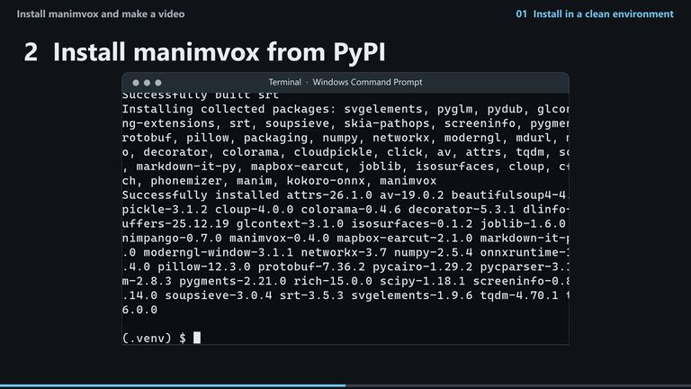
    
    Start here
    2:17, 2 minutes 17 seconds
  
  
    Install manimvox and make a video
    From an empty folder to a narrated video: a real install, recorded in a terminal, then a real Claude Code run.
    Claude Code · Sonnet 5.5 · Gnani voice
  
</a>
<a class="mvx-card" href="editing-tour/">
  
    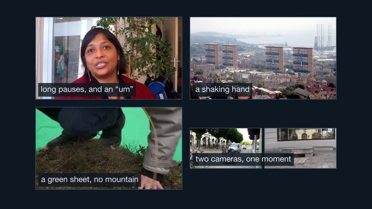
    
    13 chapters
    19:31, 19 minutes 31 seconds
  
  
    Your footage, edited
    manimvox, explaining itself: every editing tool in 0.8.0 and 0.8.5, explained and shown on real footage, made end to end by an AI agent.
    Claude Code · Opus 5.5 · Kokoro voice
  
</a>
<a class="mvx-card" href="edited-interview/">
  
    
    
    1:25, 1 minute 25 seconds
  
  
    An interview, edited
    A real 2013 interview cut by its own words: captions, a lower third, question cards, a narrated diagram and music that dips under speech.
    Claude Code · Opus 5.5 · Kokoro voice
  
</a>
<a class="mvx-card" href="dna-packing/">
  
    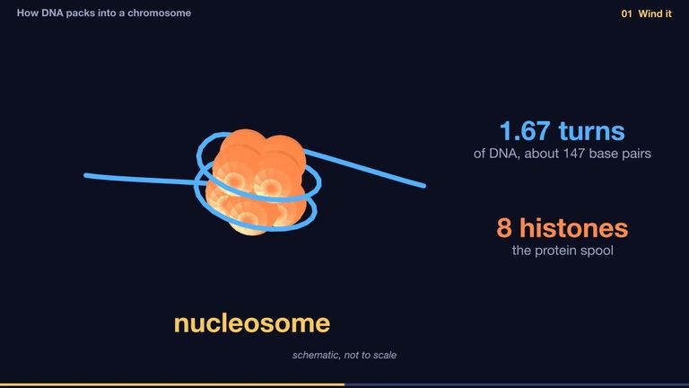
    
    Benchmark
    1:05, 1 minute 5 seconds
  
  
    How does two metres of DNA pack into a chromosome?
    One prompt, two models: a 3D explainer of DNA wound on histone spools, looped and packed, by Fable 5.2 and Opus 5.5 side by side.
    Claude Code · Fable 5.2 and Opus 5.5 · Kokoro voice
  
</a>
<a class="mvx-card" href="tapered-bearing/">
  
    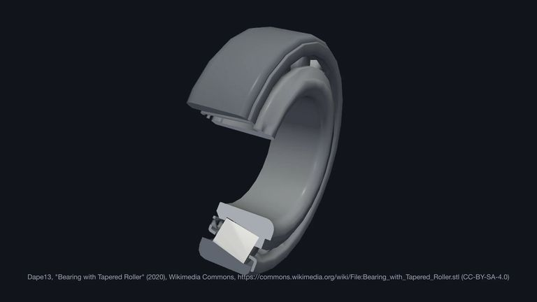
    
    0:57, 57 seconds
  
  
    What lets a loaded wheel turn so freely?
    From a car wheel to the bearing inside it: a real part cut open a quarter at a time, and why the rollers are tapered.
    Claude Code · Sonnet 5.5 · Kokoro voice
  
</a>
<a class="mvx-card" href="page-cache/">
  
    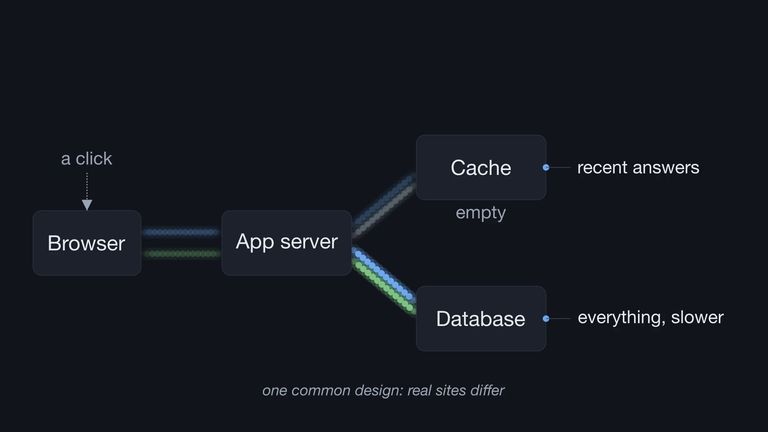
    
    0:44, 44 seconds
  
  
    Why is the same page faster the second time?
    One request, two trips through a browser, an app server, a cache and a database, with flows that go where the voice says.
    Claude Code · Sonnet 5.5 · Kokoro voice
  
</a>
<a class="mvx-card" href="which-site/">
  
    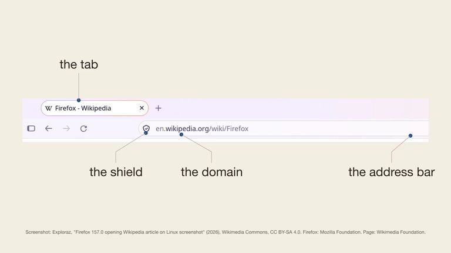
    
    0:41, 41 seconds
  
  
    Which site am I on?
    A real browser window, its top strip lifted out and named part by part, until the answer is clear: the domain.
    Claude Code · Sonnet 5.5 · Kokoro voice
  
</a>
<a class="mvx-card" href="hash-map/">
  
    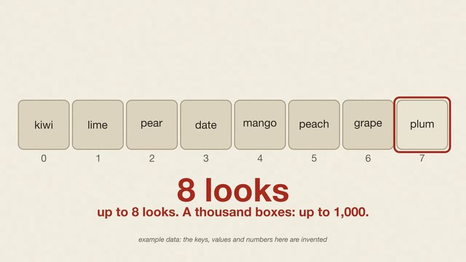
    
    0:58, 58 seconds
  
  
    How a hash map finds a key
    Why a dict does not search: the key becomes a shelf number. Paper and ink, one shelf from the first frame to the answer.
    Claude Code · Sonnet 5.5 · Sarvam voice
  
</a>
<a class="mvx-card" href="directed-videos/">
  
    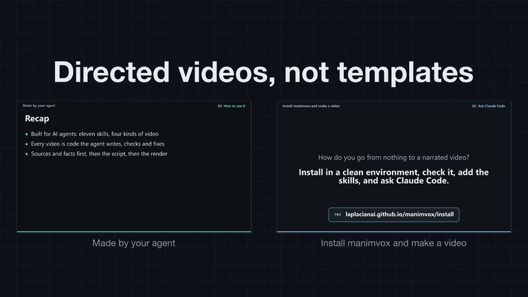
    
    0:53, 53 seconds
  
  
    Directed videos, not templates
    A pull request walkthrough: why every manimvox video looked the same, and the options that let each video choose its own shape.
    Claude Code · Sonnet 5.5 · Sarvam voice
  
</a>
<a class="mvx-card" href="made-by-your-agent/">
  
    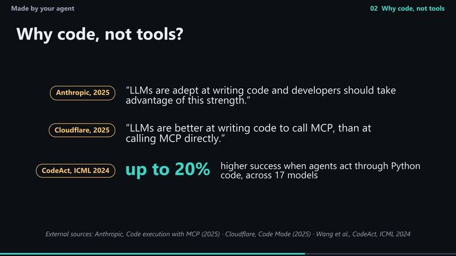
    
    1:48, 1 minute 48 seconds
  
  
    Made by your agent
    What manimvox is, why the agent writes code instead of calling tools, and how to use it from a coding agent.
    Claude Code
  
</a>
<a class="mvx-card" href="heart/">
  
    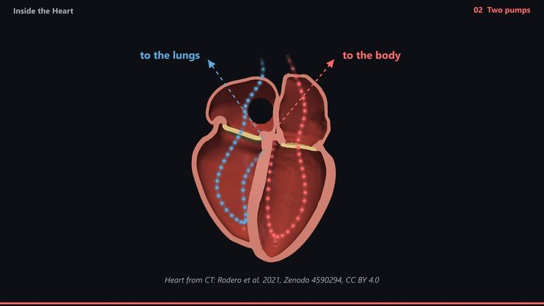
    
    1:20, 1 minute 20 seconds
  
  
    Inside the heart
    A real human heart, rebuilt from a CT scan, sliced open to its four chambers, with blood followed through it.
    Claude Code · Kokoro voice
  
</a>
<a class="mvx-card" href="upi/">
  
    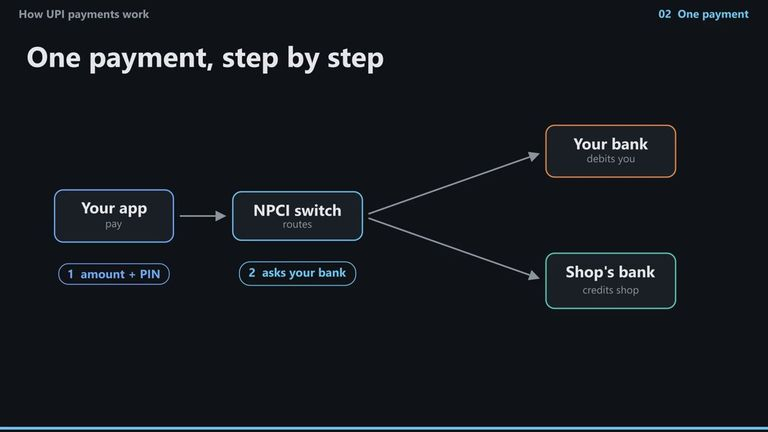
    
    Benchmark
    1:27, 1 minute 27 seconds
  
  
    How UPI payments work
    How one payment crosses two banks in seconds: four parties, five steps.
    Claude Code · Sonnet 5.5 · Gnani voice
  
</a>

## Add yours

Made a video with manimvox, by hand or with an agent? [Share it](https://github.com/LaplacianAI/manimvox/issues/new?template=gallery.yml) with a link to its source project. Every claim needs a source in its `FACTS.md`, and every model, image and voice must allow sharing.
